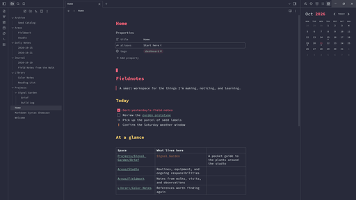
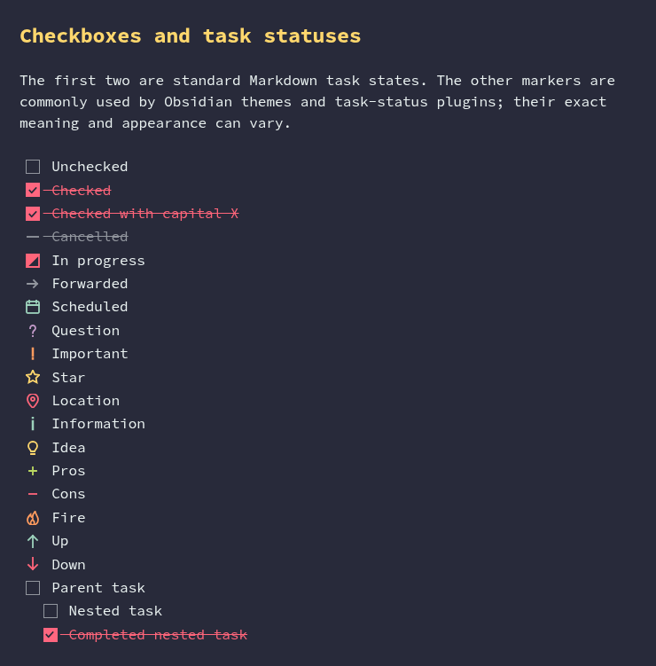

# Monokai Pro Octagon for Obsidian

An Obsidian dark theme based on the Octagon variant of [Monokai Pro](https://monokai.pro/).

Monokai Pro Octagon brings a deep blue-gray interface and vivid syntax colors to Obsidian. Choose a palette accent, colorize headings, or switch between squared and rounded corners with the optional [Style Settings](https://github.com/mgmeyers/obsidian-style-settings) plugin.

## Screenshots

### Dashboard



### Task statuses



## Palette

| Role | Color |
| --- | --- |
| Background | `#282a3a` |
| Foreground | `#eaf2f1` |
| Red | `#ff657a` |
| Green | `#bad761` |
| Yellow | `#ffd76d` |
| Orange | `#ff9b5e` |
| Purple | `#c39ac9` |
| Teal | `#9cd1bb` |
| Selection | `#535763` |
| Cursor | `#b2b9bd` |

## Install

### Community themes

Once the theme is available in Obsidian's Community themes, open **Settings → Appearance → Themes → Manage**, search for **Monokai Pro Octagon**, and select **Install**. Then select it as your active theme.

### Manual installation

Create `.obsidian/themes/Monokai Pro Octagon/` in your vault and copy `theme.css` and `manifest.json` into it. In Obsidian, open **Settings → Appearance** and select **Monokai Pro Octagon** as the active theme.

## Customize

Customization is optional. Install and enable the Style Settings community plugin, then open **Settings → Style Settings → Monokai Pro Octagon** to configure:

- Accent color
- Heading colors: enable colored headings and choose a palette color for H1–H6
- Blockquote border color
- Numbered and bulleted list marker colors
- Checkbox color
- Internal, external, and unresolved link colors
- Rounded corners (squared by default)

Internal and external links are underlined only while hovered and retain their color on hover.

Please report theme issues in this repository's GitHub Issues tab. Include your Obsidian version, operating system, relevant plugins, and steps to reproduce. Plugin interfaces may change independently of the theme.

## Development

The Sass source is split by responsibility under `scss/`; `scss/main.scss` compiles to the root-level `theme.css` used by Obsidian and releases.

The repository includes a Nix flake that provides Node.js and npm. With Nix installed and flakes enabled:

```sh
nix develop .
npm ci
npm run build
npm run lint
```

Use `npm run watch` to rebuild `theme.css` while editing. Reload the theme in Obsidian to preview changes. Linting also runs in GitHub Actions.

## Releasing

Update `manifest.json` and `versions.json` for a release, then push a tag matching the manifest version. The existing GitHub Actions workflow creates a draft release with `manifest.json` and `theme.css` attached. See the [Obsidian theme release guide](https://docs.obsidian.md/Themes/App+themes/Release+your+theme+with+GitHub+Actions).

## Credits and license

The palette is based on [Monokai Pro](https://monokai.pro/), specifically its Octagon variant. This theme maps those colors to Obsidian's interface and syntax highlighting, with additional surface shades derived from the base background.

The repository's [LICENSE](LICENSE) applies to the theme source. Palette assets and names may be subject to separate upstream terms; check those terms before redistributing the palette independently.
